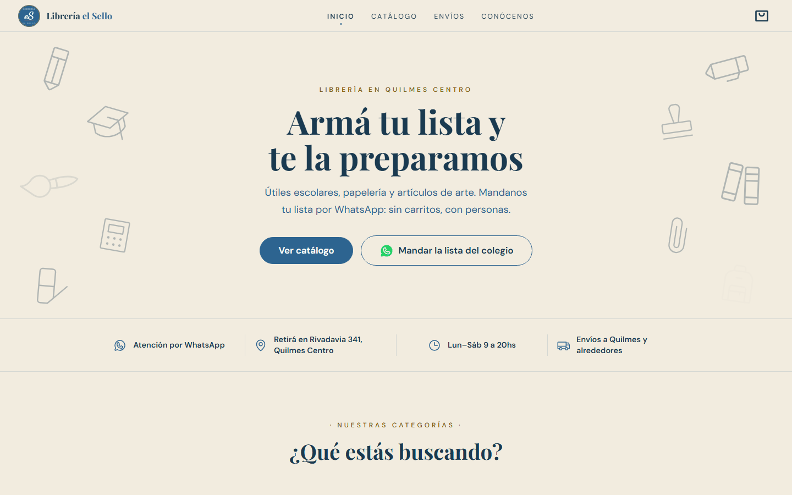
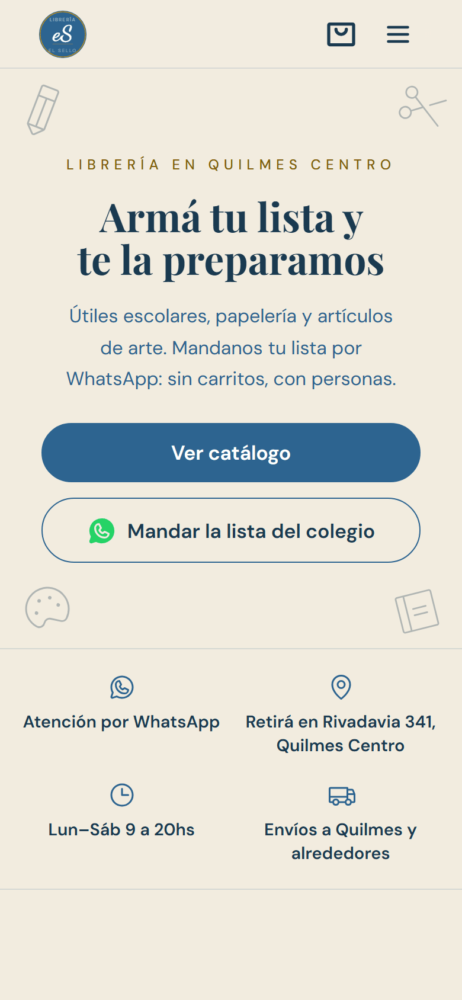
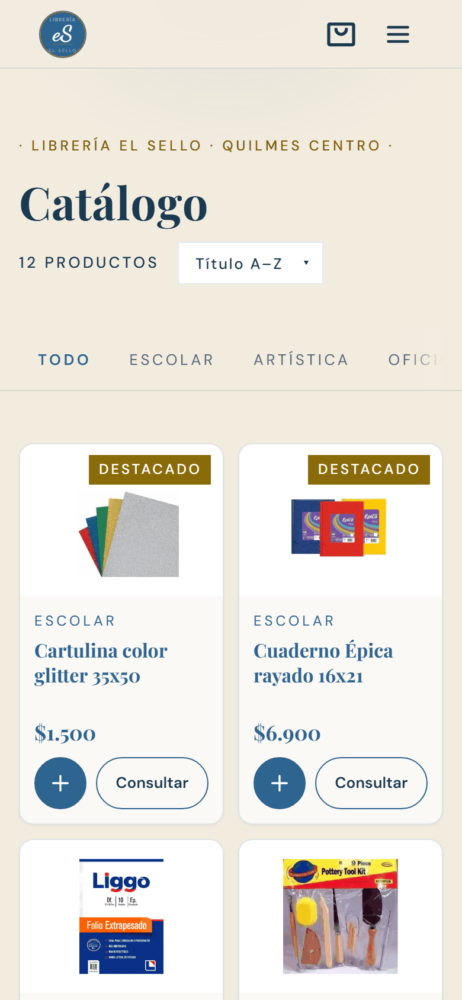
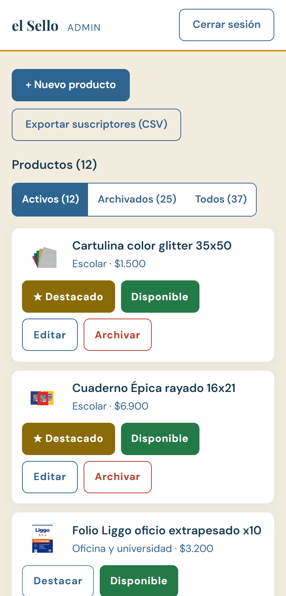
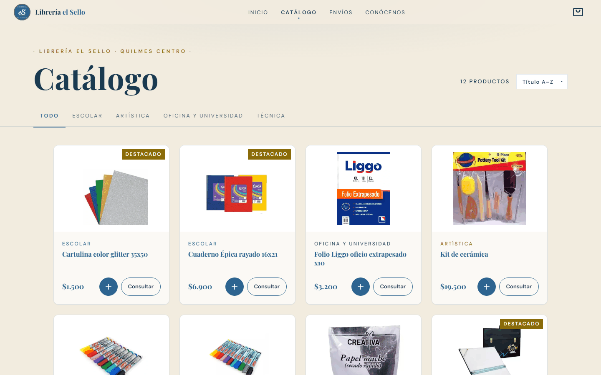
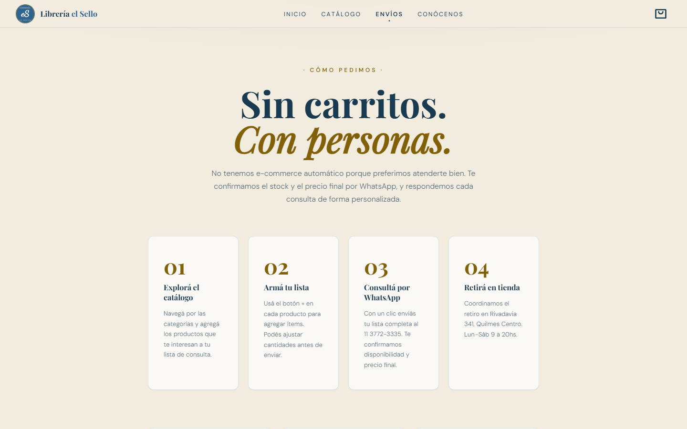
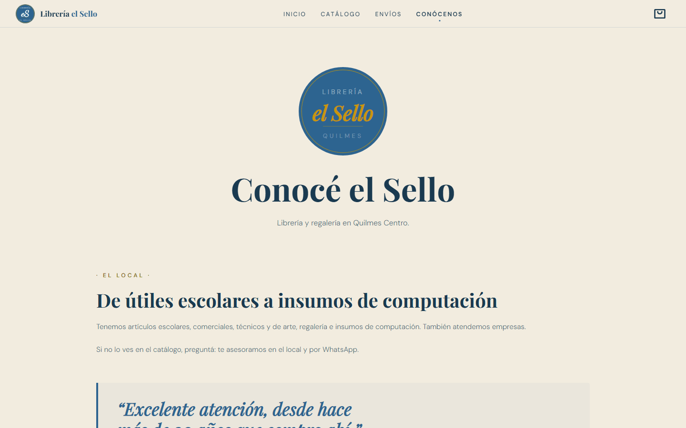
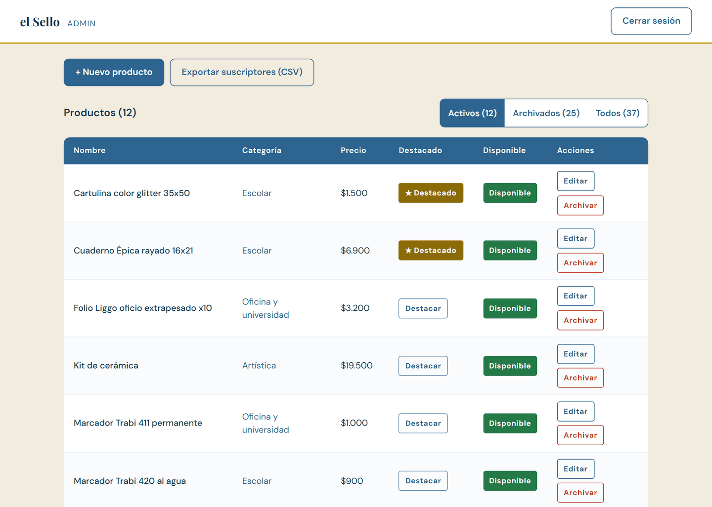

# Librería el Sello

A WhatsApp-first catalog for a neighborhood stationery shop in Quilmes, Argentina.

**Live demo:** https://libreria-el-sello.vercel.app



## Context

This is a portfolio project built for a real local shop: the products, the Google reviews and the address are real. It was not commissioned.

The shop already sells online through Tiendanube. This project explores a different model: customers build a list (for example, the school supply list) and send it by WhatsApp. There is no cart and no checkout. The site's own line for it is *"Sin carritos. Con personas."* ("No carts. With people.").

The site has `noindex` until the owner approves it.

## Features

### Storefront

- Catalog by category, with the category kept in the URL (`/catalogo?cat=escolar`).
- List builder: customers add products and quantities, and the site composes the WhatsApp message for them.
- Out-of-stock products stay visible (greyed out, marked "Agotado") with a "Consultar" action that asks about availability, instead of disappearing from the catalog.
- Real Google reviews, an FAQ and a store info strip (pickup address, hours, delivery area).
- Newsletter signup with explicit opt-in.
- Accessible on mobile: one `<main>` per page, labelled controls, focus management in the list drawer and the mobile menu, 44 px touch targets.

### Admin (`/admin`)

- Supabase Auth (email and password, public signups disabled) plus an admin role check on the server.
- Create and edit products, toggle "featured" and "in stock", archive and restore. Products are never deleted.
- Image upload with client-side compression.
- Subscriber export to CSV.

## Tech stack

| Area | Tools |
|---|---|
| Frontend | React 19, TypeScript, Vite |
| Styling | Tailwind CSS v4, design tokens in CSS custom properties |
| State and routing | Zustand, React Router v7 |
| Motion | Motion (with `LazyMotion`), Lenis |
| Icons | Phosphor Icons |
| Backend | Supabase: Postgres, Auth, Storage, Row Level Security |
| Hosting and CI | Vercel, GitHub Actions |

## Key decisions

### 1. WhatsApp-first instead of checkout

The shop already has an online store with checkout (Tiendanube), so this site tries the other path: it helps customers build their list and hands it to a person on WhatsApp, who confirms stock and the final price. That removes payments, order states and stock reservations from the scope, and the product doesn't need a cart.

### 2. Supabase and Row Level Security instead of a custom backend

There is no API server. The browser talks to Postgres directly, and every rule lives in the database:

- `is_admin()` is a `security definer` function (with an empty `search_path`) that checks an `admins` table nobody can read through the API.
- Anonymous visitors can only read active products. Admins can read everything, insert and update.
- There is no `DELETE` policy on products at all.
- The subscriber list can be written by anyone (newsletter signup) but read only by admins.

The policies were tested in the SQL editor by switching roles (`set role anon`, then a non-admin and an admin user), each test inside a transaction that ends in `rollback` (`supabase/verify_rls.sql`).

### 3. Soft delete: archived and out of stock are separate columns

`activo` means "this product is part of the catalog". `disponible` means "it is in stock right now". Archiving (`activo = false`) hides a product from the public site but keeps its history and its photo, and it can be restored. Running out of stock (`disponible = false`) keeps the product visible so customers can still ask about it.

### 4. Client-side image pipeline

Photos are processed in the browser before they reach Storage:

- Resized to a maximum of 1200 px on the longest side (never upscaled), with EXIF orientation applied so phone photos aren't rotated.
- Encoded as WebP. Safari can't encode WebP and silently returns a PNG instead, so the code checks the blob type and falls back to JPEG on a white background.
- Every upload gets a unique path, so files can be cached for a year as immutable without ever serving an old photo.
- The old file is deleted only after the database update succeeds. If the update fails, the new upload is removed instead.
- With RLS blocking it, `storage.remove()` doesn't return an error, only empty data. The code treats empty data as a failure.

### 5. CSV export that opens correctly in Excel

The subscriber export starts with a UTF-8 BOM (without it, Excel in Spanish breaks accented characters), uses `;` as the separator (Excel's list separator for Spanish locales) and escapes values that start with `=`, `+`, `-` or `@` to prevent formula injection.

### 6. Design system and WCAG AA contrast

- Colors, fonts and surfaces live in `tokens.css` as Tailwind v4 theme tokens. Every `font-family` uses `--font-display` or `--font-body`.
- One button system and one card system for the whole storefront, instead of per-page styles.
- Contrast was checked against WCAG AA with calculated ratios. Example: the brand gold `#c8960c` reaches only 2.28:1 on the beige background, so text uses a darker gold token (4.96:1).

### 7. Performance

- Catalog, Envíos and Conócenos are lazy routes, prefetched when the browser is idle. A small wrapper renders the page directly once its chunk has loaded, so there's no loading flash.
- `LazyMotion` with `domAnimation` instead of the full Motion bundle.
- Self-hosted fonts with `preload`, and fallback fonts with adjusted metrics (`size-adjust`, `ascent-override`) to reduce layout shift while they load.
- Supabase is kept out of the home bundle: it is loaded only by the catalog, the admin and the newsletter form.
- A CLS of 0.07 came from the hero's top margin collapsing through `#root` and `body`, so the whole page moved down when React mounted. It was fixed with `#root { display: flow-root }`.

### 8. Running on free tiers

The free Supabase plan pauses a project after 7 days without activity. A GitHub Actions workflow (`.github/workflows/supabase-keepalive.yml`) makes a light query every 3 days. If it doesn't get a 200 the job fails, so GitHub sends an email.

## Results

Lighthouse on mobile (PageSpeed Insights, slow 4G), measured on the published site:

| Measurement | Performance | Accessibility | Best Practices | FCP | LCP | CLS |
|---|---|---|---|---|---|---|
| Baseline (published, before the SEO pass) | 82 | 94 | 100 | 3.6 s | — | 0 |
| After the SEO pass | 83 | 100 | 100 | 3.5 s | 3.5 s | 0.07 |
| Final | **92** | **100** | **100** | **2.2 s** | **2.7 s** | **0** |

The SEO pass introduced a CLS of 0.07. The cause was the hero's margin collapsing through `#root` and `body`, not the fonts, and `display: flow-root` fixed it.

- Main bundle: 782.5 kB → 442.0 kB.
- JavaScript needed for the home page's first render: 201.8 kB → 145.6 kB transferred.

SEO scores 66 because the site is intentionally `noindex` until the owner approves it.

## Screenshots

<table>
  <tr>
    <td align="center" width="33%"><br>Home (mobile)</td>
    <td align="center" width="33%"><br>Catalog (mobile)</td>
    <td align="center" width="33%"><br>Admin (mobile)</td>
  </tr>
</table>

| | |
|---|---|
|  |  |
| Catalog | How to order (Envíos) |
|  |  |
| About the shop (Conócenos) | Share preview (Open Graph image) |



## Run locally

### Requirements

- Node.js 20.19+ or 22.12+ (required by Vite 8)
- A Supabase project (the free plan is enough)

### Environment

```bash
cp .env.local.example .env.local
```

Fill in `VITE_SUPABASE_URL` and `VITE_SUPABASE_ANON_KEY` from your Supabase project (Project Settings → API).

The anon key is public by design: it ships in the browser bundle of any Supabase app. Security comes from Row Level Security, not from hiding the key.

### Database

Run the SQL files in `supabase/` by hand in the Supabase SQL Editor, in this order:

1. `schema.sql`: `categories` and `products` tables, RLS, public read of active products.
2. `seed.sql`: 4 categories and 24 sample products.
3. `subscribers.sql`: newsletter table and its RLS.
4. `add_disponible_column.sql`: the `products.disponible` (in stock) column.
5. `admins.sql`: `admins` table and the `is_admin()` function. Then uncomment the last line with your email to make your user an admin.
6. **Manual step:** in Storage, create a **public** bucket named `productos`. No SQL file creates it, and the next file configures it.
7. `rls_admin_policies.sql`: admin-only policies for products, subscribers and the `productos` bucket (2 MB limit, WebP/JPEG/PNG only).
8. `categorias_reales.sql`: renames the 4 categories to the shop's real ones.
9. Optional: `verify_rls.sql`, the role-switching tests. Each block ends in `rollback`. Replace `REEMPLAZAR_UUID_ADMIN` with your admin user's id first.

Don't run these two on a new database:

- `products_write_policies.sql` is historical: `rls_admin_policies.sql` replaces it and drops its policy.
- `archivar_seed.sql` archives the original seed by its exact `created_at` timestamp, so it matches nothing on a fresh database. For the same reason, block 3 of `categorias_reales.sql` has no effect there.

### Start

```bash
npm install
npm run dev
```

Other scripts: `npm run build` (type check and production build), `npm run lint`, `npm run preview`.

## Project structure

```
src/
├── components/      shared UI: Navbar, Footer, ProductCard, list drawer, newsletter
│   ├── admin/       admin forms, product list, image field, protected route
│   ├── envios/      illustrations for the Envíos page
│   ├── hero/        home hero
│   ├── home/        home sections: info strip, reviews, FAQ, final CTA
│   └── illustrations/  animated SVG illustration (globe)
├── constants/       categories, FAQ and reviews (single source of truth)
├── pages/           Home, Catalog, Envíos, Conócenos
│   └── admin/       admin login and dashboard
├── services/        Supabase client, products, product images, subscribers
├── store/           Zustand stores: list (persisted) and auth
├── styles/          design tokens and self-hosted fonts
├── types/           shared TypeScript types
├── utils/           CSV export
└── config.ts        shop data, WhatsApp links, site URL
```

## Roadmap

- Owner approval, then remove `noindex` and submit the sitemap for indexing.
- The owner's own photos (product photos currently come from the shop's Tiendanube store).
- Import the catalog from Tiendanube instead of loading products by hand.
- Mercado Pago payments (out of scope for now: the current model is WhatsApp-first).

## Author

**Valentín Campos Nualart** — Full-stack developer, Quilmes, Buenos Aires.

- LinkedIn: https://www.linkedin.com/in/valentin-campos-nualart-2b6362206/
- GitHub: https://github.com/ValentinCN

## How it was built

AI-assisted development is part of my workflow. I used Claude Code to implement and refactor the code, while I directed the work: I defined the architecture, the phases and the acceptance criteria for each change, reviewed every diff, ran the SQL and Row Level Security tests myself, and verified each phase in the browser at 375, 768 and 1280 px before committing.
